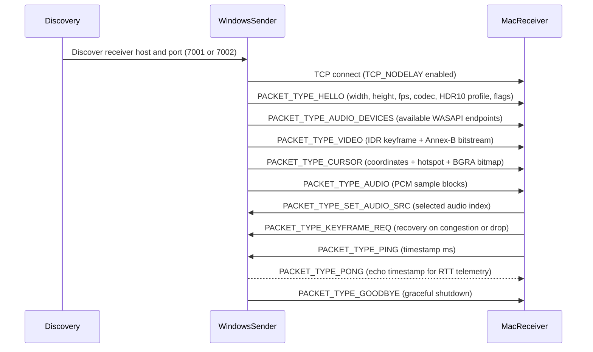

# WinMirror System Architecture

WinMirror (`v2.5.5`, publisher `karnajitop`) is a native C++ / Objective-C++ ultra-low-latency screen, audio, and cursor streaming system between a Windows host (`winmirror.exe` + `winmirror_rt.dll`) and a macOS receiver (`WinMirror.app` / OBS receiver).

---

## 1. End-to-End Media & Control Pipeline

```mermaid
flowchart LR
    subgraph winHost ["Windows Sender (winmirror.exe)"]
        guiLayer["GuiWindow (Win32 Acrylic + D2D/DWrite)"]
        updaterMod["Updater (WinHTTP Pre-Launch Check)"]
        screenCap["ScreenCapture (DXGI / WGC / GDI + pollCursor)"]
        audioCap["AudioCapture (WASAPI Loopback / Mic)"]
        gpuEnc["Encoder (D3D11 VideoProcessor + NVENC / MFT)"]
        rtDll["WinMirrorRuntime (winmirror_rt.dll MMCSS + Timer)"]
        airSrv["AirPlayServer (TCP 7001 Server / 7002 Client)"]
        beaconSvc["Beacon (mDNS 5353 + UDP 8889 + Probe 7002)"]
        btBridge["BluetoothBridge (RFCOMM SDP Control)"]
    end

    subgraph wireNet ["Local Transport Layer"]
        tcpMedia["WMIR Binary Stream (TCP 7001 / 7002)"]
        udpDisc["Discovery (mDNS 5353 + UDP 8889)"]
        rfcommCtrl["Bluetooth RFCOMM Channel"]
    end

    subgraph macRecv ["macOS Receiver (WinMirror.app / OBS)"]
        macBeacon["NSNetService + UDP Discovery Listener"]
        macBt["IOBluetoothRFCOMMChannel Delegate"]
        vtDec["VTDecompressionSession (HEVC 10-bit / H.264)"]
        dispLayer["AVSampleBufferDisplayLayer (SDR / HDR10 PQ)"]
        aqOut["AudioQueue PCM Playback"]
        macCursor["Cursor Overlay Layer"]
    end

    updaterMod -->|"Launches Main UI"| guiLayer
    rtDll -->|"MMCSS + 0.5ms Timer"| screenCap
    rtDll -->|"GPU + Firewall Tweaks"| gpuEnc
    screenCap -->|"ID3D11Texture2D / BGRA"| gpuEnc
    screenCap -->|"CursorPayload + BGRA"| airSrv
    audioCap -->|"48kHz PCM Frames"| airSrv
    gpuEnc -->|"EncodedFrame (HEVC P010 / H.264)"| airSrv
    guiLayer -->|"Target Selection & Rescan"| beaconSvc
    guiLayer -->|"Connect / Disconnect"| airSrv

    airSrv <-->|"Framed WMIR Packets"| tcpMedia
    beaconSvc <-->|"Zero-Config Announce"| udpDisc
    btBridge <-->|"RFCOMM Metadata"| rfcommCtrl

    tcpMedia -->|"PACKET_TYPE_VIDEO"| vtDec
    vtDec -->|"CVPixelBuffer"| dispLayer
    tcpMedia -->|"PACKET_TYPE_AUDIO"| aqOut
    tcpMedia -->|"PACKET_TYPE_CURSOR"| macCursor
    udpDisc -->|"Host Discovery"| macBeacon
    rfcommCtrl -->|"Paired Transport"| macBt
```

---

## 2. Wire Protocol & Streaming Handshake

All media, cursor, audio device selection, and latency probes share the packed 20-byte `PacketHeader` framed by `PACKET_MAGIC` (`0x574D4952`, `"WMIR"`) defined in [src/Common.h](src/Common.h).

### Packed Header Layout (`#pragma pack(push, 1)`)

| Field | Size | Description |
|---|---|---|
| `magic` | `uint32_t` | `0x574D4952` (`WMIR`) frame sync marker |
| `type` | `uint16_t` | `PacketType` (`0x01` HELLO through `0x0A` GOODBYE) |
| `flags` | `uint16_t` | Video bit `0` = IDR keyframe, bit `1` = HDR10 PQ |
| `payloadSize` | `uint32_t` | Payload byte length (guarded up to 24 MiB) |
| `extra1` | `uint32_t` | Video: `(codec << 24) \| (colorProfile << 16) \| (width & 0xFFFF)`; Audio: `sampleRate` |
| `extra2` | `uint32_t` | Video: `ptsMs`; Audio: `channels \| (bitsPerSample << 16)` |

---

## 3. Core Subsystem Design

### A. Display Capture & Cursor Independence (`ScreenCapture`)
- **Primary GPU Path:** DXGI Desktop Duplication (`IDXGIOutputDuplication`) / Windows Graphics Capture (`WGC`) writes directly into double-buffered `ID3D11Texture2D` surfaces with `GDI` readback fallback when restricted or headless.
- **Cursor Decoupling:** `ScreenCapture::pollCursor` samples cursor visibility, coordinates, hotspot offsets, and BGRA bitmaps independently so pointer motion stays silky-smooth even when the screen image is completely static (`shouldAcceptDxgiFrame` in `CapturePolicy.h` guards against uninitialized `0x0` DXGI frames).

### B. Hybrid / Optimus GPU Color & Encode Pipeline (`Encoder`)
- **Cross-GPU Bridging:** On hybrid laptops (`NvOptimusEnablement = 1`), desktop duplication runs on the display-owning iGPU while `Encoder` discovers NVIDIA adapter (`0x10DE`) to spin up a dedicated NVENC MFT device and flushes `D3D11VideoProcessor` blits to GPU queue immediately.
- **Ranked Fallback Plan:**
  1. `NVENC HEVC 10-bit HDR10 (GPU ZC / GPU)` (`DXGI_FORMAT_P010`, BT.2020 G2084 PQ)
  2. `NVENC HEVC 8-bit` / `NVENC H.264` (`DXGI_FORMAT_NV12`, BT.709 G22)
  3. Generic Hardware MFT `HEVC` / `H.264`
  4. Windows Software `H.264` MFT fallback
- **scRGB / HDR10 Mapping:** Converts `DXGI_FORMAT_R16G16B16A16_FLOAT` (Windows 11 scRGB linear HDR) and `DXGI_FORMAT_R10G10B10A2_UNORM` directly to `YCBCR_STUDIO_G2084_LEFT_P2020` via `D3D11VideoProcessor`.

### C. Queue-Less Streaming & Congestion Control (`AirPlayServer`)
- Sockets set `TCP_NODELAY` and per-client worker threads drain dedicated bounded queues.
- If a slow network stalls a client socket, stale video frames are evicted cleanly and `waitingForKeyframe` requests an immediate IDR sync (`PACKET_TYPE_KEYFRAME_REQ`) instead of building multi-second latency drift.
- Supports both passive server hosting (port `7001`) and direct UI-initiated outbound connections (`connectToReceiver` on port `7002`).

### D. Multi-Transport Zero-Config Discovery (`Beacon` & `BluetoothBridge`)
- **mDNS (`MdnsParser.h`):** Listens/queries UDP `5353` with DNS label pointer compression loop protection (`MAX_JUMPS = 16`).
- **UDP Broadcast Beacon:** Announces and listens on UDP `8889` (`BEACON_PORT`).
- **Subnet Receiver Probe:** Actively scans local subnets on TCP `7002` to discover direct OBS receivers without displaying raw IPs in the user interface.
- **Bluetooth RFCOMM:** Advertises WinMirror SDP UUID `{8F4A2C10-7B3E-4E91-9A02-574D49520001}` for out-of-band pairing metadata and interface negotiation.

### E. Windows UI, Runtime DLL & Anti-Reverse (`GuiWindow`, `WinMirrorRuntime`, `SecProtect`)
- **Frameless Acrylic Chrome:** `WS_POPUP | WS_MINIMIZEBOX | WS_SYSMENU` main window (`WS_POPUP` splash) with `WM_NCCALCSIZE = 0`, `WM_NCPAINT = 0`, and `WM_NCACTIVATE = TRUE`, explicit `WM_SETICON` (`ICON_BIG` / `ICON_SMALL`) taskbar icons, minimize-to-tray hiding (`ShowWindow(SW_HIDE)`), and 70%-transparent blurred Acrylic obsidian/crimson/white Direct2D/DirectWrite chrome (`GlassCanvas.h`).
- **Privacy-First Display:** Receiver cards show friendly names and status (`OBS Receiver • Ready` / `AirPlay Receiver • Ready`), omitting raw LAN IP addresses from GUI panels and tray menus.
- **Unified Branding:** Multi-resolution `src/app_icon.ico` (`16`–`256` px) embedded via `src/winmirror.rc`, Inno Setup `SetupIconFile`, and bilinear-sampled `48x48` `kAppIcon48` in `src/AppIconData.h` for header/splash/fallback icons.
- **Companion Runtime (`winmirror_rt.dll`):** Applies `MMCSS` Pro Audio / Games scheduling, high-resolution multimedia timers, firewall exceptions (`TCP 7001`, `UDP 8889`), GPU registry preferences, and optional 4K 120/240Hz Virtual Display Driver provisioning (`--install-vdd`).
- **Binary Hardening (`SecProtect.h`):** Compile-time FNV/SplitMix XOR string keystream (`WM_OBF` / `WM_OBF_W`) hides GitHub API URLs and registry/window strings from static PE `strings` extraction, paired with runtime debugger guards (`enforceAntiReverse`, `hideCurrentThread`) and zeroization helpers (`wipeString`, `wipeWString`).

---

## 4. Pre-Launch Auto-Updater & Self-Replacement Flow

```mermaid
flowchart LR
    winMain["WinMain Launch (no --no-update)"] --> splashUi["Splash Window (WS_POPUP)"]
    splashUi --> cleanOld["cleanupPreviousUpdateBinary (.old.exe / .tmp)"]
    cleanOld --> headCheck["HEAD /releases/latest (WinHTTP TLS 1.2/1.3)"]
    headCheck -->|"302 Location /tag/vX.Y.Z"| verCmp{"isNewerVersion(remote, local)?"}
    headCheck -->|"Redirect unavailable"| apiFallback["JSON API Fallback (/releases/latest)"]
    apiFallback --> verCmp
    verCmp -->|"No update"| verifyDll["Updater::ensureCompanionDll (winmirror_rt.dll)"]
    verCmp -->|"Newer tag found"| dlExe["Download winmirror.exe.update.exe (CDN)"]
    dlExe --> peCheck{"isValidPeHeader (MZ)?"}
    peCheck -->|"Invalid / Portal"| verifyDll
    peCheck -->|"Valid PE"| swapMove["moveReplaceWithRetry (strip Zone.Identifier + 25x120ms)"]
    swapMove -->|"Success"| relaunchProc["Relaunch Updated EXE (with UAC runas fallback)"]
    swapMove -->|"Locked Error"| rollbackPrev["Rollback .old.exe -> Main Launch"]
    relaunchProc --> exitOld["Exit Previous Process"]
    verifyDll --> mainGui["Launch WinMirror Main Window"]
    rollbackPrev --> mainGui
```

---

## 5. Build, CI & Distribution Matrix

| Component | Source Entry | Local macOS Cross-Build (`build.sh`) | GitHub Actions CI (`release.yml`) |
|---|---|---|---|
| `winmirror_rt.dll` | `src/WinMirrorRuntime.cpp` | `zig c++ -target x86_64-windows-gnu -shared` | MSVC `cl.exe /O2 /MT /LD /GL` |
| `winmirror.exe` | `src/*.cpp` + `src/winmirror.rc` | `zig c++ -target x86_64-windows-gnu` | MSVC `cl.exe /GL /SUBSYSTEM:WINDOWS` + `rc.exe` (`app_icon.ico` + manifest) |
| `WinMirror-Setup.exe` | `installer/winmirror.iss` | — | Inno Setup 6 `ISCC.exe` (`SetupIconFile`, `--install`, desktop icon, cleanup) |
| `WinMirror.app` & `WinMirror.dmg` | `mac/main.mm` + `assets/app_icon_mac.png` | `clang++` + `sips` + `iconutil` + `hdiutil` | `macos-latest` (`./build.sh mac`) |
