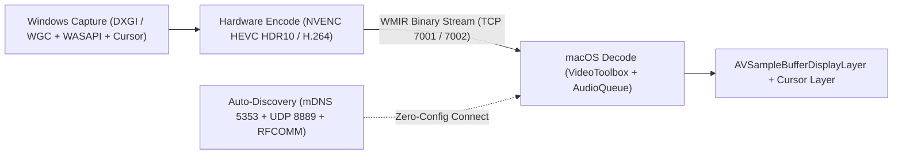

<p align="center">
  
</p>

<h1 align="center">WinMirror AirPlay</h1>

<p align="center">
  <strong>Ultra-Low-Latency GPU Screen, Cursor & Audio Mirroring (Windows &rarr; macOS)</strong><br />
  <code>v2.5.4</code> &bull; by <strong>karnajitop</strong>
</p>

<p align="center">
  <a href="https://github.com/1zyxu/winmirror/releases/latest">Latest Release</a> &bull;
  <a href="ARCHITECTURE.md">System Architecture</a> &bull;
  <a href="https://github.com/1zyxu/winmirror/actions">CI Builds</a>
</p>

---

## Overview

WinMirror streams your Windows desktop, hardware mouse cursor, and system/microphone audio to macOS over USB-C tethering, Wi-Fi/LAN, or Bluetooth discovery with sub-frame GPU capture (`DXGI` / `WGC`) and hardware `NVENC` / `Media Foundation` encoding (`HEVC` 10-bit HDR10 PQ & `H.264`).

See [ARCHITECTURE.md](ARCHITECTURE.md) for sequence diagrams, packet wire format specifications (`WMIR`), and updater internals.



---

## Key Capabilities

- **GPU-Native Capture & Encode:** Captures frames in GPU VRAM via DXGI Desktop Duplication / WGC and encodes directly through NVIDIA `NVENC` (including Optimus dual-GPU bridging) or Media Foundation `HEVC` (10-bit `P010` HDR10 PQ / 8-bit `NV12`) and `H.264`.
- **Decoupled Cursor & Audio:** Streams hardware cursor position/hotspot/bitmaps alongside WASAPI audio frames with live audio source switching from the receiver.
- **Queue-Less Real-Time Transport:** `TCP_NODELAY` sockets drop stale frames under congestion and issue `PACKET_TYPE_KEYFRAME_REQ` recovery to prevent latency buildup.
- **Frameless Acrylic Windows UI:** Obsidian, crimson, and crisp white Direct2D/DirectWrite chrome (`WS_POPUP`) with receiver auto-discovery, name-only privacy badges (raw IPs hidden in the UI), system tray controls, and custom squircle branding.
- **Hardened Pre-Launch Auto-Updater:** Zero-rate-limit GitHub `releases/latest` redirect check over TLS 1.2/1.3, MZ PE verification, Defender lock-retry file replacement, and runtime companion DLL recovery (`winmirror_rt.dll`).
- **Multi-Transport Discovery:** Supports mDNS (`UDP 5353`), UDP Beacon (`UDP 8889`), direct OBS subnet probe (`TCP 7002`), and Bluetooth RFCOMM pairing (`{8F4A2C10-7B3E-4E91-9A02-574D49520001}`).

---

## Installation & Quick Start

### Windows Sender (`winmirror.exe`)
1. Download **`WinMirror-Setup.exe`** (recommended installer) or `winmirror-windows.zip` from the [Latest Release](https://github.com/1zyxu/winmirror/releases/latest).
2. Run **`WinMirror AirPlay`**. On launch, the pre-launch splash checks GitHub Releases for updates before starting the main window.
3. Click any discovered Mac/OBS receiver row to start mirroring video, cursor, and audio, or enter a host name in the manual input bar.

#### Optional CLI Flags
```cmd
winmirror.exe --port 7001 --fps 60
```
- `--port <number>`: TCP media server port (default `7001`).
- `--fps <number|auto|unlimited>`: Override capture/encode frame rate (`auto` matches display refresh; `unlimited` / `max` / `uncapped` removes cap).
- `--no-update`: Skip the pre-launch GitHub auto-update check.
- `--update-only`: Apply updates if available and exit.
- `--check`: Run `winmirror_rt.dll` preflight diagnostics cleanly in console.
- `--install`: Configure firewall (`TCP 7001`, `UDP 8889`), MMCSS/GPU preferences, and runtime components (run automatically by `WinMirror-Setup.exe`).
- `--install-vdd`: Install the 4K 120/240Hz HDR Virtual Display Driver package (requires Administrator).

### macOS Receiver (`WinMirror.app`)
1. Open **`WinMirror.dmg`** from [Latest Release](https://github.com/1zyxu/winmirror/releases/latest) and drag `WinMirror.app` into `/Applications` (or run CLI `./winmirror_mac [host] [port]`).
2. WinMirror automatically publishes Bonjour `_winmirror._tcp.`, listens for UDP `8889` beacons, and monitors Bluetooth RFCOMM so your Windows PC discovers your Mac without manual IP entry.

---

## Building from Source

### On macOS (Cross-Compiles Windows + Native macOS)
Requires `zig` (`0.14.1+`), Xcode Command Line Tools (`clang++`, `sips`, `iconutil`, `hdiutil`):
```bash
./build.sh all    # Builds winmirror.exe, winmirror_rt.dll, winmirror_mac, WinMirror.app, WinMirror.dmg
./build.sh win    # Windows targets only
./build.sh mac    # macOS app bundle + DMG only
```

### CI Release Builds
Tagging `v*` triggers [.github/workflows/release.yml](.github/workflows/release.yml):
- **`windows-latest`:** MSVC `cl.exe /O2 /GL` + `rc.exe` (`app_icon.ico` + manifest) + Inno Setup 6 `ISCC.exe` -> `winmirror.exe`, `winmirror_rt.dll`, `winmirror-windows.zip`, `WinMirror-Setup.exe`.
- **`macos-latest`:** `./build.sh mac` -> `winmirror_mac`, `WinMirror.dmg`.

---

## Repository Layout

| Path | Purpose |
|---|---|
| `src/` | Windows sender, DXGI/WGC/GDI capture, NVENC/MFT encoder, WASAPI audio, acrylic UI, auto-updater, security obfuscation, `.ico`/pixel logo, `winmirror_rt.dll` |
| `mac/` | Native Cocoa `VideoToolbox` HDR10/SDR decoder, `AVSampleBufferDisplayLayer`, `AudioQueue` playback, Bonjour + Bluetooth receiver |
| `installer/` | Inno Setup 6 installer script (`winmirror.iss` &rarr; `WinMirror-Setup.exe`) |
| `assets/` | `1024x1024` master squircle app icons (`app_icon.png`, `app_icon_mac.png`) |
| `.github/workflows/` | Automated MSVC + Inno Setup + macOS universal release workflow |
| `ARCHITECTURE.md` | Full Mermaid system topology, `WMIR` sequence diagram, and module deep dive |
